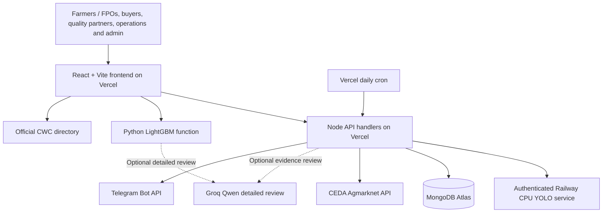

# AgriTrace

An agricultural marketplace connecting farmers and FPOs with buyers, quality partners, storage and logistics workflows. Market evidence, produce photos and partner reviews stay linked to a sell lot.

**[Live application](https://agritrace-eosin.vercel.app)**

Built by **Coke&Code** for **Build Beyond 26**, problem statement **4.2: AI-Powered Agricultural Marketplace with quality verification and price intelligence**.

Team: Aditya Banerjee, Raj Nandani and Vatasal Mittal, BMS College of Engineering.

## Features

| Area | Current capability |
| --- | --- |
| Market intelligence | Observed CEDA mandi prices, price movement, seasonal comparisons, regional buyer demand and transport/storage cost deductions |
| Quick ML recommendation | Direct LightGBM price-direction output with a short recommendation, without a Qwen request |
| Detailed advisory | Optional Groq Qwen review of supplied evidence or prepared model predictions and sale conditions |
| Sell lots and procurement | Individual lots, FPO aggregation, buyer demands, partial/full bids, negotiation and trade records |
| Produce quality | Photo upload, hosted tomato detection/ripeness assessment and manual partner approval or correction |
| Storage discovery | Four real CWC directory listings with official sources and clearly marked approximate map locations |
| Operations | Payment demo, logistics requests, storage workflows, QR tracking and disputes |
| Telegram | Personal chat linking, daily crop/state price and demand alerts, optional price targets and delivery history |
| Administration | Separate admin entry and workspace, role checks, user management and interactive charts |

### Crop and model coverage

Observed market intelligence supports **wheat, rice, potato, tomato, onion, mustard, cotton, apple and chickpea**. References are commodity-level rather than variety-specific quotes.

The supplied **LightGBM weights cover only tomato, potato and onion**. Inference requires all **40 engineered features** in the original training units and feature order. The application loads pretrained artifacts; it does not train models at runtime or manufacture missing features. Quick mode uses `review:false` to bypass Qwen. Other crop tabs explain the missing trained categories while retaining observed market intelligence.

**Automated photo grading currently supports tomato only.** The supplied potato files are general COCO detectors, and no onion quality model was supplied. Unsupported crops require manual grading. Tomato grades are provisional visual sample estimates, with uncertainty handling, not laboratory or whole-lot certificates. Quality partners can inspect the original photo and approve or correct the grade while preserving the AI result.

CEDA queries refresh on first use at most once per India calendar day for each query. Empty and failed refreshes also consume that day's attempt. Stale or missing observations withhold guidance. Historical movement and Qwen review do not verify future prices.

## Architecture



Node handlers serve marketplace, quality, notification and operational APIs. MongoDB stores accounts, lots, demands, bids, private photos, review history, trade records, CEDA snapshots and delivery logs. Railway runs photo inference separately from Vercel. Signed account tokens, role and ownership checks protect relevant records; provider credentials remain server-side.

Some operational screens retain labeled demo data. Storage listings are discovery references, not integrated booking partners. Rates, capacity, crop acceptance and cold-chain suitability require operator confirmation.

## Local development

Prerequisites: a Node.js version supported by Vite 8, npm, MongoDB access and Python for local LightGBM inference. The forecast requirements target Python 3.12 in deployment.

```bash
npm install
python -m pip install -r requirements.txt
npm run dev -- --host 127.0.0.1 --port 5175
```

The Vite development server also serves the project's API routes. Open the local URL printed by Vite. See [MongoDB setup](docs/mongodb-setup.md) for Atlas configuration.

Create an ignored `.env` file with the variables needed for the features you use:

| Variable | Purpose |
| --- | --- |
| `MONGO_URI` | MongoDB connection string |
| `JWT_SECRET` | Server-side account token signing secret |
| `CEDA_API_TOKEN` | CEDA market-data access |
| `GROQ_API_KEY` | Optional detailed Qwen review |
| `QUALITY_INFERENCE_URL` | Hosted quality inference POST endpoint |
| `QUALITY_SERVICE_TOKEN` | Token for the hosted quality service |
| `TELEGRAM_BOT_TOKEN` | Telegram bot token from BotFather |
| `TELEGRAM_BOT_USERNAME` | Bot username without `@` |
| `TELEGRAM_WEBHOOK_SECRET` | Secret for validating Telegram webhook requests |
| `CRON_SECRET` | Bearer secret for scheduled market alerts |
| `PUBLIC_APP_URL`, `FRONTEND_URL`, `APP_BASE_URL` | Public application origin settings |
| `PAYMENT_GATEWAY_PROVIDER` | Use `TEST_UPI` for the demo |

Keep secrets out of Git and never expose them through `VITE_` variables. Hosted services need their own environment configuration.

### Model artifacts

The market model loads these files from `model/`:

| File | Purpose |
| --- | --- |
| `lgbm_final.txt` | Trained LightGBM weights |
| `le_target.pkl` | UP / DOWN / STABLE label encoder |
| `cat_mappings.pkl` | Categorical feature mappings |
| `feature_cols.csv` | Ordered 40-feature input contract |

Preserve the original model file bytes and compatible Python dependencies. See [pretrained model setup](docs/pretrained-market-model.md).

For local YOLO inference, install PyTorch appropriate for your environment and `services/quality/requirements.txt`, then supply the expected weights under `yolo_best_weights/`. Alternatively configure the hosted inference URL and token. See [produce quality setup](docs/produce-quality.md) for the model files, policies and service contract.

## Telegram price and demand alerts

Open the account menu, select **Notification settings**, connect Telegram and press **Start** in the bot. Return to the website and refresh status. Enable market alerts, select a crop and state, and choose prices, new buyer demand, or both. Leave both price targets blank for a daily observed-price update.

Production checks run daily around **9–10 am IST**. Only opted-in, personally linked chats receive alerts. Demand-only subscriptions do not fetch CEDA. Price subscriptions reuse the daily cache. `/stop` pauses Telegram delivery.

After configuring the production secrets and deploying, register the webhook using the public HTTPS application origin:

```bash
node scripts/configure-telegram-webhook.mjs
```

Set `PUBLIC_APP_URL` or `TELEGRAM_WEBHOOK_BASE_URL` before running the script. It preserves queued updates and does not print tokens. See [Telegram setup and delivery behavior](docs/telegram-market-alerts.md).

## Payments and deployment

The current payment flow uses **TEST_UPI**, including payment intent, QR and reference recording. It is not a live settlement or escrow integration. A production rollout requires a real payment provider, reconciliation and the appropriate operational controls.

The frontend and APIs deploy on **Vercel**, private data persists in **MongoDB Atlas**, and tomato photo inference runs in a separate **Railway** container. See [deployment instructions](docs/vercel-deployment.md) for build packaging, environment variables and inference configuration.

## Verification

```bash
npm run lint
npm test
npm run build
node api/_utils/cedaDailyCache.selfcheck.js
node api/_utils/cropMarketIntelligence.selfcheck.js
node api/_utils/producePricing.selfcheck.js
node api/ai/intelligence.selfcheck.js
python api/ai/mandi-forecast.selfcheck.py
```

The market/cache self-checks use controlled fixtures without unnecessary CEDA requests. Model checks use the supplied weights and mock external review calls. These verify software behavior, not measured model accuracy or farmer-income impact. The hosted-quality smoke script creates and removes isolated test records and requires configured production access.

## Documentation

- [Market intelligence](docs/crop-market-intelligence.md)
- [Pretrained LightGBM model](docs/pretrained-market-model.md)
- [Produce quality and partner review](docs/produce-quality.md)
- [Storage directory and quick recommendations](docs/storage-and-quick-recommendations.md)
- [Marketplace API](docs/marketplace-api-v1.md)
- [Telegram alerts](docs/telegram-market-alerts.md)
- [MongoDB setup](docs/mongodb-setup.md)
- [Vercel and Railway deployment](docs/vercel-deployment.md)
